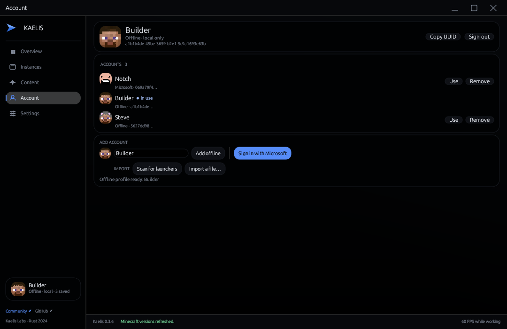
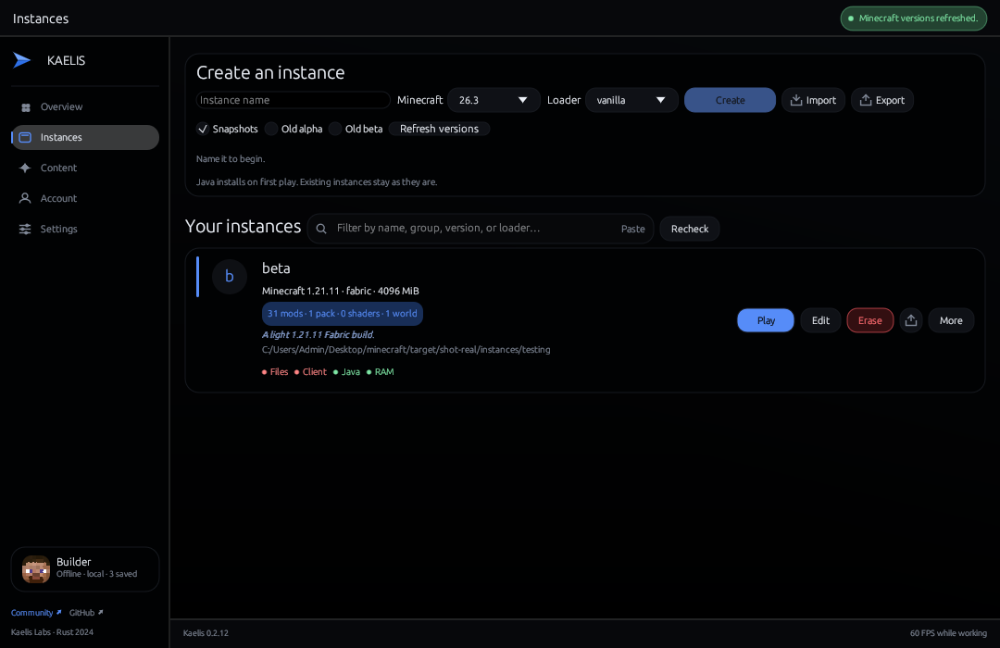
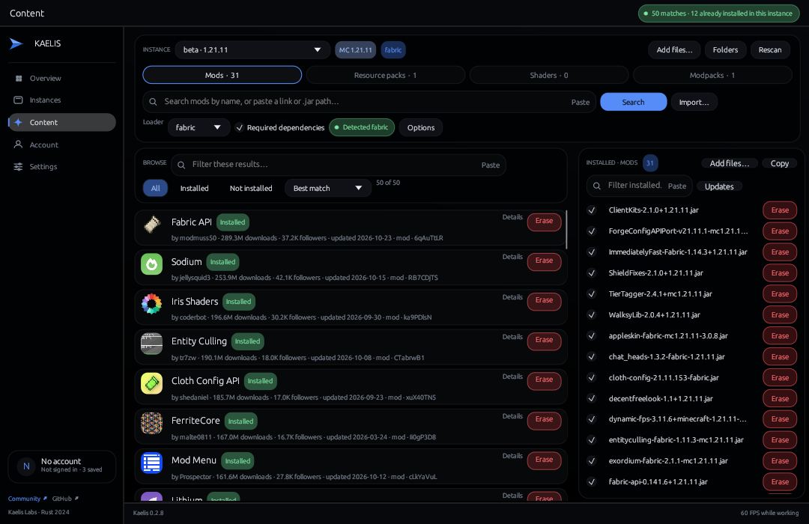
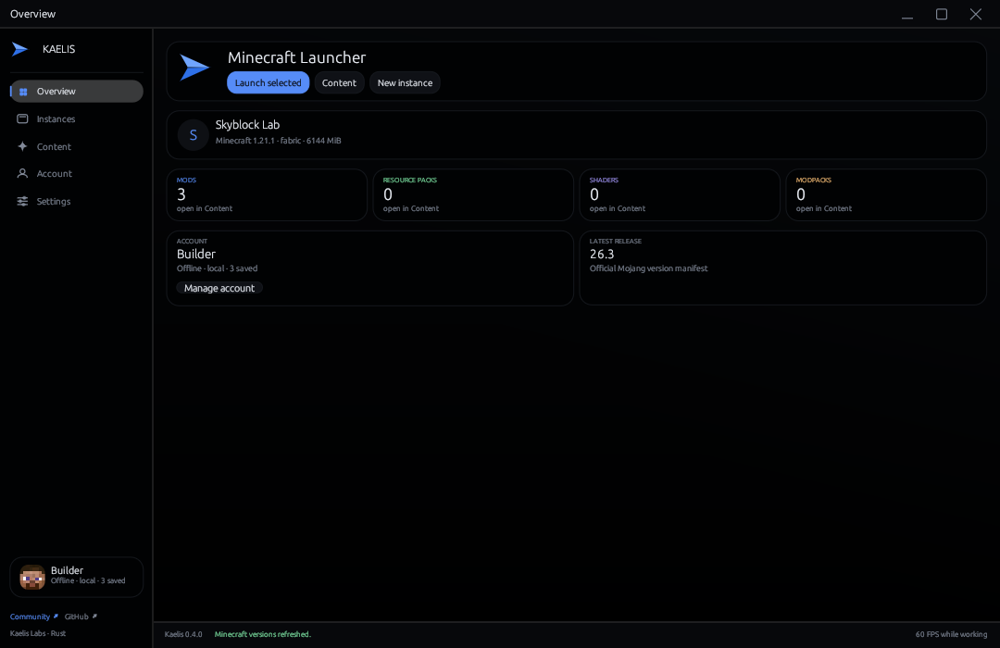

# Kaelis - Fastest & Lightest Minecraft Launcher




**Minecraft, composed.** The fastest and lightest way to run Minecraft: a
native Rust launcher for Windows, macOS, and Linux with one calm library for
instances, modpacks, mods, resource packs, and shaders — and power features that
keep that library clean, correct, and fast on their own.

[Website](site/index.html) · [Releases](https://github.com/fuvji/kaelis/releases) · [Issues](https://github.com/fuvji/kaelis/issues) · [Community](https://discord.gg/fvrdYzrQjq)

## Power features

| Feature | What it does |
| --- | --- |
| **Auto Erase Junk** | Clears logs, crash dumps, loader caches (including Architectury Transformer scratch), mod download caches, typed command history, extracted natives, stale server packs, heap dumps, interrupted downloads even when they keep their real name, OS thumbnail files inside content folders, and stale official-launcher state (including its saved Microsoft profile and credential) at every start and after every game — capped so it can never stall startup. Folders it does not recognise are always kept |
| **One copy of the game** | Every verified download — libraries, assets, client jar, Java runtime — is hard-linked into a content-addressed store, so a second instance of the same version occupies a few extra MB instead of another 600 MB. Store entries no instance references are pruned automatically |
| **Auto-repair before launch** | Scans the instance's mods and installs missing required mods (for example `ukulib` for uku's Armor HUD) before the JVM starts |
| **Auto-disable duplicates** | Keeps the newest jar when two files provide the same mod id, so the older copy cannot crash the game first |
| **Required dependencies** | Every install resolves and downloads the dependency graph — Modrinth and CurseForge alike |
| **Verified mod updates** | Hash-matches installed jars, finds the newest compatible release for each, and replaces it only after SHA-1 verification; disabled jars stay disabled |
| **Keyless catalogue** | Modrinth and the entire CurseForge catalogue — search, paging, resource packs, shaders — with no API key and no account |
| **Managed Java** | Installs the Mojang runtime the version metadata names and launches through it, so no system JDK is required |
| **Portable instances** | One `.kaelis.zip` round trip, plus Prism/MultiMC, CurseForge, `.mrpack`, and loose pack imports |
| **Runs in parallel, quietly** | Per-instance OS guards let different instances launch together; a smart power governor drops every unfocused game to idle priority within 1.5 s and restores it the moment it is focused, so the game being played owns the CPU |
| **Reopens, never doubles** | One process, one tray icon: a second launch, a Start-menu click, or the tray icon restores the running window in ~120 ms instead of starting another launcher — including over a fullscreen game |
| **Hibernates while you play** | Starting a game hides the window and empties its working set, and 90 s unfocused does the same while the window stays open; one tray click restores it, mid-game included |
| **Tray-first window** | The title-bar minimize button and **Show / Minimize** in the tray hide the launcher to the notification area and give its pages back. The tray icon itself toggles: a click restores a hidden or taskbar-minimised window, and hides a visible one. The native menu is forced dark and is three actions plus one separator |
| **Updates in one click** | One anonymous GitHub request runs in the background after the window is up. When a newer release exists, the footer version links to it and an **Update** action installs the build right there: the download is SHA-256-verified against the same release, the old executable is backed up, and a failed swap rolls back. Nothing downloads or installs on its own |
| **Starts with Windows** | One optional per-user sign-in entry opens Kaelis hidden in the tray, with no service, scheduled task, splash, or focus steal. Enable or disable it in Settings or with `kaelis --startup on\|off` |
| **Survives a launcher restart** | A game's process id and creation time are recorded when it spawns, so reopening Kaelis still shows Quit for a game that is running, keeps a second JVM off the same world, and can end that game from the card |
| **Private by default** | RAM-only instance logs, no telemetry, no analytics, no background daemon, nothing stored that the OS credential store can hold instead |

**Auto Erase Junk never guesses.** It removes only what Minecraft or Kaelis
regenerates on the next launch: `logs`, `crash-reports`, `.cache`, `.mixin.out`,
`.fabric`, `.quilt`, `.connector`, `.architectury-transformer`, `cache`,
`debug`, `temp`, `natives`, and `server-resource-packs`; staging files ending `.part`, `.tmp`, or `.download`
with or without a leading dot, in the root and in every content folder; OS
folder noise (`Thumbs.db`, `.DS_Store`, `desktop.ini`) wherever it lands; and
root-level files that only hold diagnostics, caches, history, or another
launcher's leftovers (`command_history.txt`, `usercache.json`, `hs_err_pid*`,
`java_pid*`, `.attach_pid*`, `.hprof`, `.replay`, `realms_persistence.json`,
`servers.dat_old`, `launcher_ui_state.json`, and the official launcher's saved
profiles and credential files). Saves, mods, configuration, resource packs,
shaders, screenshots, options, and every folder whose name it does not
recognise — such as a leftover `tmpmkzllels1` — are never touched. A symlinked
instance root is refused rather than followed, and a hostile folder cannot slow
startup past 50,000 inspected entries.

**The same bytes are stored once.** A verified file is hard-linked into
`<data>/content`, keyed by its SHA-1, before any later instance can ask for it:
the download layer checks the store first, so a second instance of the same
version links 443 MB of assets, 66 MB of libraries, the client jar, and the
100 MB Java runtime in place of downloading them. Hard links are one inode with
two names, so deleting an instance never damages another, and a store entry that
no instance references is pruned from disk. A store on another volume, or a
filesystem without hard links, simply falls back to a normal download.

`kaelis --clean [--json]` runs the same pass with no window: junk from every
instance, a one-time share of files that predate the store, and a prune of
unreferenced cache.



## Performance

Measured on the published Windows 0.2.11 artifact with `tools/bench.ps1` (5 runs,
warm disk cache, window detected through UI Automation) on 2026-10-25:

| Metric | Result |
| --- | --- |
| `kaelis --version` | 78 ms median, 91 ms p95 |
| Window, empty data root | 336 ms median |
| Window, 200-jar instance | 341 ms median |
| Working set (idle) | 98.3 MB empty, 91.7 MB with 200 jars |
| Private bytes (idle) | 90.8 MB empty, 91.1 MB with 200 jars |
| Idle CPU | 0.00% median (event-driven, no repaint loop) |
| Handles | 495 empty, 498 with 200 jars |
| Hibernated working set | 1.6 MB after 90 s unfocused (path unchanged since 0.2.10) |
| Published Windows binary | 17,039,872 B, SHA-256 `ddca9a30…` |
| Second launch restore | 62 ms (handoff + native window wake; path unchanged since 0.2.10) |
| Window close to process exit | 16 ms (path unchanged since 0.2.10) |

The window does not wait for mod metadata: jar scanning and artwork decoding
run on workers, so a 200-mod instance opens in the same time as an empty one.
The window figure is the one that moves with the host: the same machine
recorded 177 ms for 0.2.10 earlier in the day and 307–341 ms for both 0.2.10 and
0.2.11 in the same later session, so today's absolute number is host state, not
a regression. Working set, private bytes, handles, and idle CPU are the figures
that stay put.
Startup no longer walks the temp folder before the window: the background
sweeper's first tick does it on the runtime. Pack downloads use 8 parallel
transfers, and an idle launcher schedules no frames at all. The binary carries
both renderers, so a session without OpenGL 2.0 still opens a window through
Direct3D 12; that fallback is the largest part of the size above. Run the same benchmark after a change with
`powershell -NoProfile -ExecutionPolicy Bypass -File tools/bench.ps1`; it writes
`target/bench-report.json`. These are single-machine numbers, not a ranking
against other launchers, and the absolute window time moves with the host: the
same machine recorded 362 ms for 0.1.3 on a different day without any change to
the window path, so a number that looks slower here is the machine, not the
launcher. The working set and handle count are the figures that stay stable.

## What's new in 0.2.11

- **The instance card no longer says “Never played”.** An instance that has
  never been started shows only what it contains: its mod, pack, shader, and
  world counts. A played instance still shows its relative session time, and
  the counts read naturally — `1 pack · 1 world`, never `1 packs` or `1 worlds`.
- **Auto Erase Junk reaches ReplayMod and Forge logs.** Disposable cleanup now
  also clears the ReplayMod frame cache (recordings themselves stay), the
  `fml-client-latest.log` and `fml-server-latest.log` files Forge and NeoForge
  leave beside an instance, and Windows' `ehthumbs.db` thumbnail cache. Saves,
  recordings, mods, configs, screenshots, and unknown folders are untouched.
- **One less line of clutter.** The freed chip keeps the content row on a single
  baseline at every card height, so scanning a long instance list is quieter
  and slightly faster to read.

### From 0.2.10

- **Only Windows is offered the install action.** The update check and the
  release link remain everywhere, but macOS and Linux ship as archives that are
  unpacked deliberately, so they no longer show an **Update** label that could
  only answer "already up to date".
- **A failed swap restores the launcher.** If the verified build cannot be
  copied into place — an antivirus lock that outlasts the retry window, a file
  that vanished mid-swap — the script starts the existing executable instead of
  exiting silently, so a failed install never leaves the user with no window.
- **Updates install themselves.** The footer already said when a newer Kaelis
  existed; the version now carries an **Update** action. One click downloads
  the published Windows build, hashes it while it streams in, and refuses it
  unless the SHA-256 matches the checksum in the same release. Only then does
  the launcher write a short swap script, end itself instantly, and restart
  into the new version; a failed copy rolls the old executable back. Downloads
  verify every download, and an install inside a protected folder (such as
  `Program Files`) is reported instead of being half-replaced; the version
  link still opens the release page for those installs and for macOS and Linux.
  A stale staging file is deleted at the next start, so an interrupted attempt
  never accumulates in the temp folder.
- **The tray is dark and one click.** Windows paints tray menus itself, so
  Kaelis now sets the process-wide dark menu mode before the menu exists. The
  menu is **Show / Minimize**, **Play last instance**, one separator, and
  **Quit** — three actions, no submenus. The icon itself toggles the window,
  including a window that is minimised to the taskbar.
- **Minimize means tray.** The title-bar minimize button hides the window and
  trims its working set instead of adding a taskbar button. **Show / Minimize**
  in the tray does the same, and a single click restores the window. A new
  Settings toggle, **Minimize to the tray**, turns the title-bar behavior off.
- **The detected loader is a real control-height pill.** Its height is the same
  as the combo box and every button beside it, with the text on the row's
  centre line, so Content no longer shows a short box floating above a toolbar.
- **Start with Windows, silently.** A Settings toggle adds one per-user
  sign-in entry that opens Kaelis hidden in the tray. It is a plain registry
  value — no service, no scheduled task, no splash, no window over the desktop —
  and it can also be changed with `kaelis --startup on` or `off`.
- **A reopened launcher still knows what is running.** Each game writes its
  process id and creation time when it spawns. On the next start those records
  are checked against the live process table, so the card shows Quit (not Play),
  a second JVM cannot open the same world, and Quit ends the adopted game.
  A normal launch still clears its record when the JVM exits.
- **Auto-clean is broader and safer.** It now also clears OS thumbnail files in
  content folders, the official launcher's account/profile files, `cache`,
  `.architectury-transformer` scratch, and typed-command history. It no longer
  deletes a `tmp…` folder it merely guesses at: saves, mods, configs,
  screenshots, and unknown folders always survive.
- **Content browsing is nearly twice as dense.** A result is now two lines:
  title plus provider/installed state, then author, downloads, loader support,
  and version. Descriptions and categories live in the hover and Details panel.
  The icon is 32 px, gutters are tighter, and the action area no longer overlaps
  long metadata, so a screenful holds roughly twice as many mods.
- **Update checks start themselves.** A background request asks GitHub for the
  newest tag after the first window is up. When it is newer, the footer version
  turns into a single-line link to that release. The check is anonymous, does
  not block the window, stays silent when offline, and never installs anything
  on its own.

### From 0.2.6

- **Quit ends the process now.** The tray's Quit and the title-bar close drop
  the tray icon and exit immediately instead of queuing a frame on a hidden
  window and unwinding every editor, worker, and runtime handle first. Settings
  are already written when they change and game logs are RAM-only, so nothing
  is lost, and no ghost icon is left in the notification area.
- **Play becomes Quit while the game runs.** A running instance's card turns
  its action into a red Quit, and the Overview's **Launch selected** does the
  same for the active instance. One click asks the launch task that already owns
  the JVM to end it — no process scan, no `taskkill` child, no wait for a window
  close — and the card returns to Play when the exit event lands, usually within
  a frame. A stop clicked while Java is still being prepared is kept and applied
  the moment the process exists.
- **Modrinth leads the catalogue.** Modrinth cards are listed before the
  CurseForge mirror in every order: Best match, Most downloaded, and Name A-Z.
  Download totals are not comparable between the two — the mirror counts every
  pack that ever embedded a project — so CurseForge can no longer outrank an
  exact Modrinth match. Duplicate projects still collapse to the Modrinth card.
- **A three-action tray.** Show Kaelis, Play last instance, and Quit, with one
  separator for a single glance. (0.2.7 forces the native menu dark and turns
  the first action into Show / Minimize.)

### From 0.2.5

- **Show Kaelis always appears, even over a running game.** Hiding no longer
  goes through egui's viewport at all: on Windows the real window is hidden with
  Win32, so the toolkit's visible/minimised state can never go stale and leave a
  blank frame behind. Every route — the tray menu, a left click on the tray
  icon, **Launch last instance**, a second launcher, or a Start-menu click —
  runs one native path that shows the window, restores it if minimised, lifts it
  above the game with a topmost round trip, and forces foreground through the
  game's input thread. Measured from a hidden window: back on screen in 119 ms.
- **Smart multi-instance power.** Every JVM Kaelis starts is registered with a
  governor. The game whose window owns the foreground runs at normal priority;
  every other instance drops to the idle priority class within 1.5 s and returns
  to normal the moment it is focused again. Nothing is suspended and no session
  is disconnected — a background instance simply stops competing with the one
  being played.
- **Deeper hibernation, fewer wake-ups.** Starting a game hides the launcher and
  empties its working set immediately; losing focus for 90 s does the same while
  the window stays open. The timer is armed once per focus loss and never
  re-armed, so an idle launcher truly schedules no frames. Restoring faults the
  pages back in on demand. Idle HTTP now keeps at most two sockets for 15 s
  instead of 90.
- **Auto Erase Junk reaches the last traces.** Mod download caches
  (`downloads/`), and the client's typed slash-command history are now removed
  with logs, crash dumps, loader caches, natives, server packs, heap dumps, and
  staging files — at every start, after every game, and from `--clean`.
- **Cleaner control rows.** Create is the one accent action in its row at the
  same height and width as Import/Export, Apply sits at control height, and the
  Overview account and release cards share one bottom line.

### From 0.2.4

- Tray restore first ran from the tray thread, the icon became a left-click
  target, and game-start hibernation used a working-set trim instead of only a
  hidden window.
- The HTTP pool was cut to two idle sockets with a 15 s timeout, and the create
  and apply rows were aligned to one control height.

### From 0.2.3

- **One copy of every game file.** Verified downloads are hard-linked into a
  content-addressed store before the next instance asks for them, so a second
  instance of the same version links the assets, libraries, client jar, and Java
  runtime instead of downloading or storing them again. Entries that no instance
  references are pruned; there is no copy, move, or second decompression. A
  store on another volume falls back to a normal download.
- **Reopening Kaelis always brings it back.** A second launch hands its arguments
  to the running window and exits in about 80 ms; the channel is retried for two
  seconds so a double-click during a cold start still lands, and a native window
  wake covers a lost channel. Clicking the tray icon itself restores the window,
  exactly like the tray action (now **Show / Minimize**), including while a game
  is running.
- **Auto Erase Junk found the rest.** Staging files are removed even when they
  keep their real name (`sodium.jar.part`), and the official launcher's UI state
  and saved Microsoft credential file no longer survive in an instance.
  `kaelis --clean [--json]` runs the whole pass headlessly. (0.2.5 also removed a
  crashed loader's `tmp…` folder by name; 0.2.7 no longer guesses and keeps every
  unfamiliar folder.)

### From 0.2.2

- **CurseForge is a real catalogue now.** Without a key, search reads the public
  mirror of the official v1 API — same paths, JSON, pagination, hashes, and
  dependency metadata as `api.curseforge.com` — so a typed name returns a page of
  projects instead of one exact match, and paging, resource packs, and shaders
  all work. An approved key in `CF_API_KEY` aims the identical calls at the
  official endpoint.
- **The named project ranks first.** Search asks for downloads order, because the
  endpoint's default order ignores relevance (`jei` used to return
  `seamless-ores` first).
- **Dependency graphs come for free.** Required mods install keyless, from the
  same file metadata the official API publishes.
- **Less traffic.** Catalogue pages are cached for a minute, and installs address
  files by their real id, which removes one metadata lookup per install.
- **Degrades, never empties.** If the mirror is unreachable, an exact project
  name, link, or id still resolves through the public index, and the launcher
  says so instead of showing an empty list.
- **A release republishes the site.** Publishing a tag now dispatches the Pages
  deploy, which fetches that release's downloads and hydrates the page, instead
  of waiting for a separate push.



## Quick start

Requirements: Rust 1.85 or newer and a C/C++ linker for the selected target.

| Platform | Toolchain | Extra packages |
| --- | --- | --- |
| Windows 10/11 | `stable-x86_64-pc-windows-msvc` | Visual Studio Build Tools with the C++ workload |
| macOS 11+ | `stable-aarch64-apple-darwin` or `stable-x86_64-apple-darwin` | Xcode command line tools |
| Linux | `stable-x86_64-unknown-linux-gnu` | `libgtk-3-dev libayatana-appindicator3-dev libxkbcommon-dev libwayland-dev libx11-dev` |

```bash
git clone https://github.com/fuvji/kaelis.git
cd kaelis
cargo build --release -p kaelis-launcher
```

Run `target/release/kaelis` (`kaelis.exe` on Windows), or launch a saved
instance directly:

```bash
kaelis --play fabric-1-21
```

Install it like a desktop app:

```bash
# macOS: Kaelis.app in dist/, ad-hoc signed and ready to drag to Applications
./packaging/macos/bundle.sh              # add --universal for Intel + Apple silicon

# Linux: per-user install, no root
./packaging/linux/install.sh
```

The Linux build needs `libgtk-3-dev` and `libayatana-appindicator3-dev` because
the tray icon talks to the desktop's app-indicator service; without a tray the
launcher still runs and reports it in the status line. Java is found in this
order: the instance's configured path, the runtime Kaelis provisioned, `PATH`,
then the standard JDK install folders (`/usr/lib/jvm`, `/Library/Java/…`,
`C:\Program Files\Java\…`), so a Dock- or menu-launched app that inherits no
shell environment still starts the game.

Portable instance archives work from the CLI too:

```bash
kaelis --duplicate fabric-1-21 --with-worlds
kaelis --export-instance fabric-1-21 ~/fabric-1-21.kaelis.zip
kaelis --import-instance ~/fabric-1-21.kaelis.zip
```


Both Modrinth and CurseForge are supported, and neither needs a key or account.
CurseForge is read through the public mirror of its v1 API: the same paths,
JSON, pagination, and file metadata as the official endpoint. Typing a name
searches the real catalogue, a project link or id resolves exactly, and every
install comes from the official ForgeCDN with hash and required-dependency
checks. Nothing to configure, and nothing stored.

If you hold an approved CurseForge key, exporting `CF_API_KEY` aims the same
calls at the official endpoint, which adds its per-key quota without changing
anything else in the launcher.

Sites without an API — SpigotMC, Planet Minecraft, 9Minecraft, GitHub release
pages, private packs — are covered by the link and local-file paths instead of
scrapers, so traffic stays predictable and within each site's terms.

## Accounts

Offline profiles need only a name. Microsoft sign-in needs no setup: **Account →
Sign in with Microsoft** shows a short code, copies it, opens the Microsoft page,
and finishes by itself once the page is approved. That is the public Xbox Live
client the Xbox app signs in with, so there is no Azure registration, no client
ID to paste, and no client secret anywhere in the app.

Every sign-in is exchanged through Xbox Live → XSTS → Minecraft Services, so an
account without Java Edition is refused instead of failing later at launch. The
refresh token lives in the OS credential store (Credential Manager, Keychain,
Secret Service) and restores the session on the next start without a code; the
Minecraft access token stays in zeroizing memory and is never written to disk.

## Keyboard

| Keys | Does |
| --- | --- |
| `Ctrl+1` … `Ctrl+5` | Jump to Overview, Instances, Content, Account, or Settings |
| `Tab` / `Shift+Tab` | Move focus; a focused navigation row draws a visible ring |
| `Ctrl+F` | Focus the search field on Instances or Content |
| `Ctrl+S` | Save the open instance editor |
| `Esc` | Close the open dialog, or clear the content search |
| `Ctrl+V` | Paste a copied picture as instance artwork, or text into the focused search field |

On macOS, use `Cmd` wherever `Ctrl` is listed; `Esc` and `Tab` are unchanged.

## Command line

Every operation the interface performs is also a headless command. Add `--json`
to a report and the output is one machine-readable document on stdout, with
diagnostics on stderr, so scripts and MCP servers can parse it without a GUI.

| Command | Does |
| --- | --- |
| `kaelis` | Opens the desktop launcher |
| `kaelis --version [--json]` | Build identity, platform, site and checksum URLs |
| `kaelis --status [--json]` | Data root, instance and account counts, active identity, resolved Java |
| `kaelis --clean [--json]` | Erase junk from every instance, share files that predate the store, prune unreferenced cache |
| `kaelis --list-instances [--json]` | Every instance: id, name, version, loader, mod count |
| `kaelis --list-versions [--show-alpha] [--show-beta] [--hide-snapshots] [--json]` | Newest Mojang versions |
| `kaelis --accounts [--json]` | Every saved identity, its kind, profile id, and the active one |
| `kaelis --use-account <name> [--json]` | Switches the saved identity the next launch uses |
| `kaelis --offline <name> [--json]` | Offline profile and its skin head URL |
| `kaelis --play <instance> [--offline <name>]` | Launches with the managed runtime and the saved offline identity |
| `kaelis --check-updates <instance> [--json]` | Newest compatible Modrinth version for every installed mod |
| `kaelis --update-mods <instance> [--json]` | Downloads, verifies, and installs every available mod update |
| `kaelis --install-mod <instance> <provider:project>` | Installs a mod and its required dependencies; a bare slug means Modrinth, and a CurseForge slug or numeric id both work |
| `kaelis --repair <instance>` | Reinstalls missing required dependencies |
| `kaelis --import-modpack <instance> <pack file>` | Imports an `.mrpack` or `.zip` pack into an instance |
| `kaelis --export-instance <instance> <out.kaelis.zip>` | Writes one portable archive |
| `kaelis --import-instance <archive.kaelis.zip>` | Imports it under a free id |
| `kaelis --duplicate <instance> [--with-worlds] [--json]` | Copies an instance under a free id; worlds are opt-in |

```bash
kaelis --list-instances --json
kaelis --status --json
kaelis --accounts --json
kaelis --use-account Builder
kaelis --check-updates fabric-1-21 --json
kaelis --play fabric-1-21 --offline Steve
kaelis --install-mod fabric-1-21 curseforge:reeses-sodium-options
```

Exit codes are stable: `0` success, `2` bad arguments, other non-zero values are
runtime failures. A second GUI launch hands its arguments to the running window
instead of opening a duplicate.

## Workspace

```text
crates/
  kaelis-core/       brand, instance metadata, JVM flags, user automation
                     rules and their runner, junk cleaner, RAM-only log,
                     single-instance mutex, memory sweeper
  kaelis-api/        Mojang versions, Modrinth, CurseForge, downloads,
                     Fabric/Quilt provisioning, mrpack import, portable
                     instance archives, repair, hashing, auth, launch
  kaelis-gui/        egui interface, content studio, instance editor, tray,
                     brand mark (one geometry for window, tray, and site)
  kaelis-launcher/   CLI and desktop entry point
site/                static product site and brand assets
```


Instances are plain JSON under the platform data directory:
`%APPDATA%\kaelis\Kaelis\data\instances` on Windows,
`~/Library/Application Support/gg.kaelis.Kaelis/instances` on macOS, and
`~/.local/share/kaelis/instances` on Linux. Set `KAELIS_DATA_DIR` to relocate
all launcher state; each data root also gets its own single-instance guard, so a
portable copy never blocks the installed one.

## Design rules

- Native first: every hot path stays in Rust; the UI is immediate-mode and
  paints only when needed — forced repaints run at 60 FPS only while an install
  or progress bar is on screen, and an idle launcher is fully event-driven.
- Bounded everything: image decodes, log lines, dependency walks, download
  concurrency, archive extraction, and retry loops all have hard limits.
- One pass per download: SHA-1 is computed from the stream while bytes are
  written, so a verified install never re-reads the file it just saved.
- Explicit automation: repair, duplicate resolution, the junk cleaner, and
  every user command are visible settings with conservative safety proofs,
  never silent mutations of user data.
- No hidden state: no cache daemon, no persistent event log, no telemetry endpoint.
- Small releases: fat LTO, one codegen unit, stripped symbols, abort on panic.

## Verification

```bash
cargo test --workspace
cargo clippy --workspace --all-targets -- -D warnings
cargo fmt --all -- --check
```

The workspace currently passes 244 tests (126 api, 49 core, 57 gui, 12
launcher), and Clippy is clean with warnings denied on Windows, macOS, and
Linux.

The release path also generates `dist/KAELIS-LINKS.txt`, publishes the same
bytes as [`site/downloads/KAELIS-LINKS.txt`](site/downloads/KAELIS-LINKS.txt),
and builds a fresh per-user Windows installer. The index lists every runtime endpoint,
download, installation path, and project link; `tools/links.ps1` regenerates it,
prunes legacy link files, and `-Verify` probes the static links. `tools/release.ps1`
runs it automatically after hashing the new artifacts.

## Website

The product site is a single dependency-free HTML document in
[`site/`](site/index.html). The Pages workflow at
[`.github/workflows/pages.yml`](.github/workflows/pages.yml) deploys that
directory on a push to `main` and on a published release; enable GitHub Pages →
GitHub Actions once in the repository settings. Because the EXE, ZIP, and Setup
are release assets rather than git objects, the workflow fetches them into
`site/downloads` and runs [`tools/hydrate-site.ps1`](tools/hydrate-site.ps1) so
the visible sizes and hashes always describe the files actually being served.
Brand artwork lives in [`site/assets/kaelis-mark.svg`](site/assets/kaelis-mark.svg); every raster icon and the social card is regenerated from the same geometry with `tools/make-brand-assets.ps1` (1024 px master, 16–256 px ICO, 192/512 PWA icons, 180 px touch icon, 1200x630 card). The mark is a plate-free two-plane dart (`#70a5ff` / `#2e70e8`), so the SVG, ICO, PWA icons, window icon, and site all share one transparent glyph. The film is rebuilt with `tools/build-film.ps1`: six painted stills, a slow push with editorial cuts, a scored 31.7-second 1080p60 MP4, a fresh poster, and captions generated from the same timing table; `tools/narrate.ps1` holds the narration lines and voice direction.

Preview it locally with the same MIME types the host sends:

```bash
powershell -NoProfile -File tools/serve-site.ps1 -Port 8088
```

The directory also carries `robots.txt`, `sitemap.xml` (page, screenshots, and
the intro video), `manifest.webmanifest`, and `.well-known/security.txt`. The CI
workflow fails when a `href`/`src` in the page does not resolve, when
`SHA256SUMS.txt` stops matching the binaries beside it, or when the manifest
references a missing icon.

Releases are built by [`.github/workflows/release.yml`](.github/workflows/release.yml):
a `v*` tag builds Windows, macOS (universal), and Linux, publishes one release
with every artifact, the generated `KAELIS-LINKS.txt`, and a combined
`SHA256SUMS.txt`. The Windows job installs NSIS, so `Kaelis-Setup.exe` is rebuilt
from the same fresh binary as the portable download rather than reusing an old
local setup, and the publish job dispatches the site deploy so the page can never
serve the previous release under a new version number. `tools/release.ps1` is the
same Windows path used locally.




## License

MIT · Kaelis Labs · [@epufk](https://github.com/fuvji)

Kaelis is not affiliated with Mojang Studios, Microsoft, Modrinth, or
CurseForge. Minecraft is a trademark of Mojang Studios.
