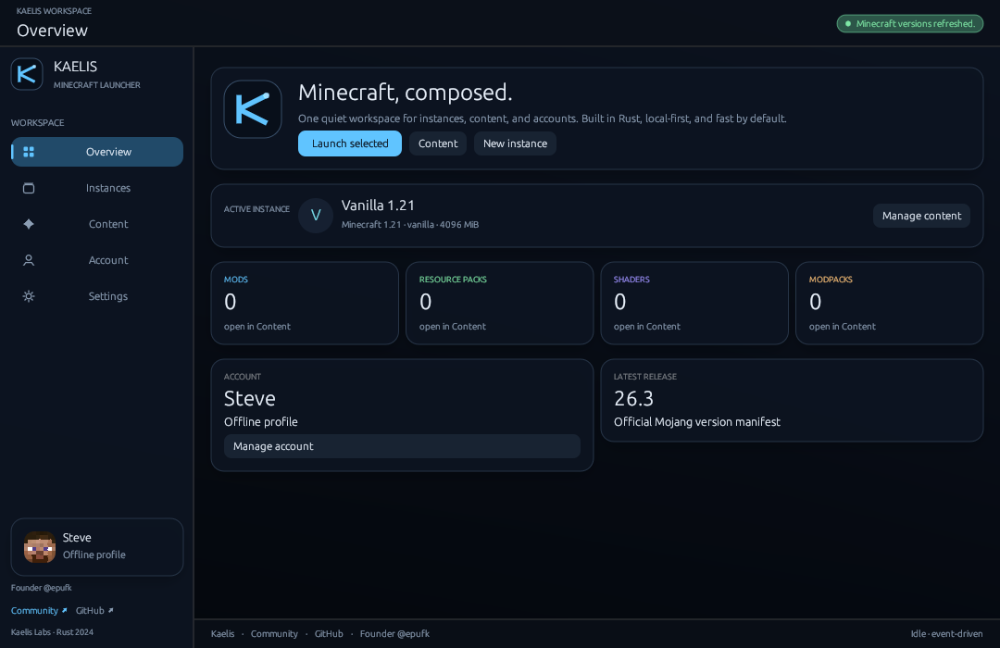
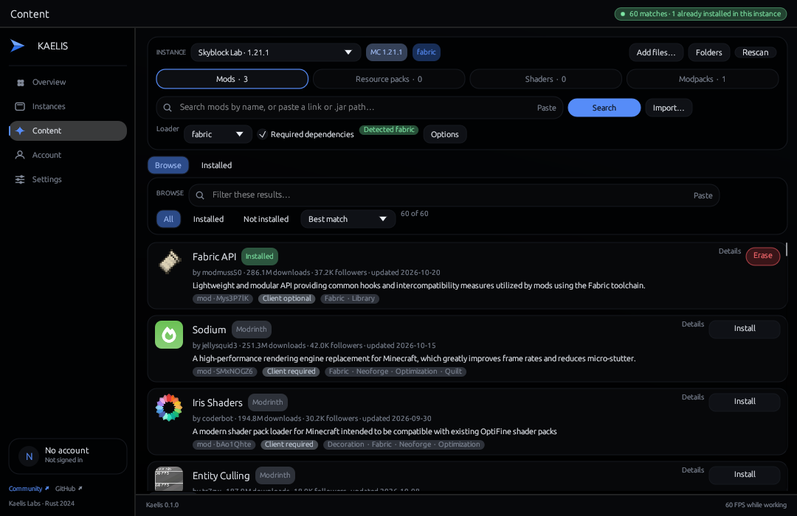
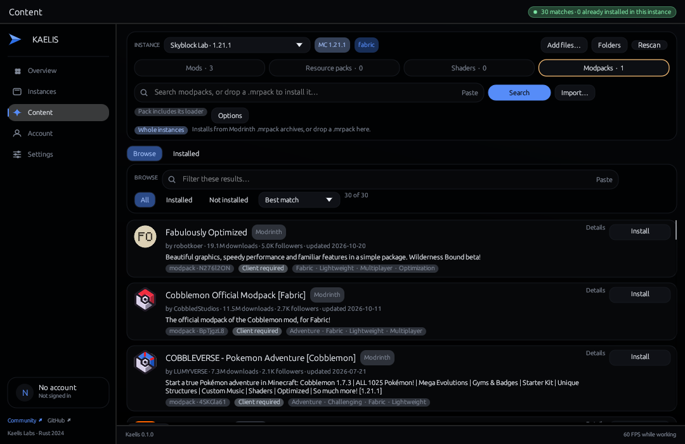
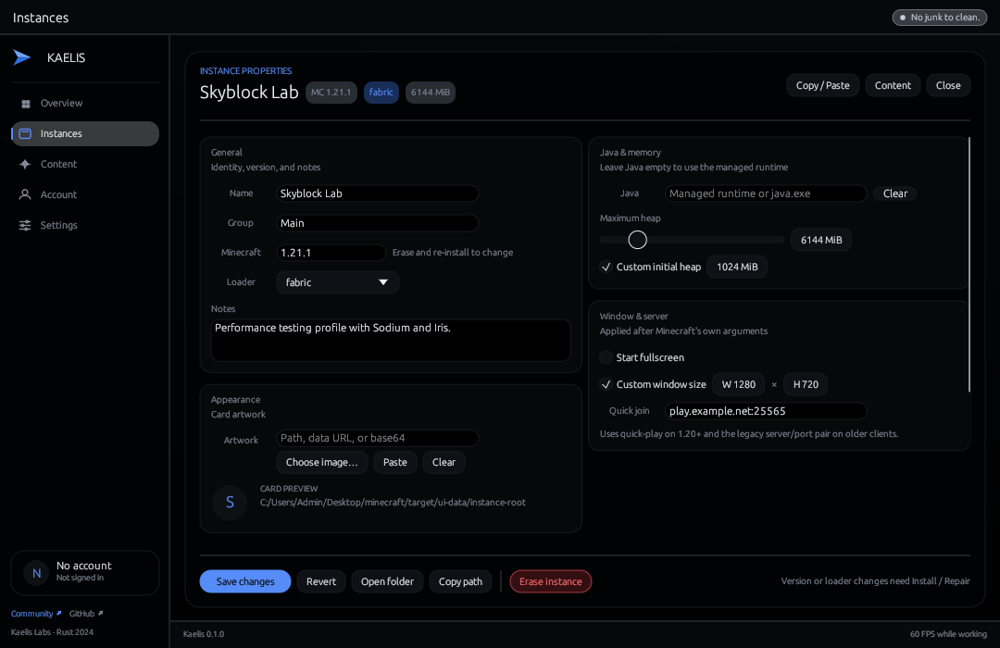
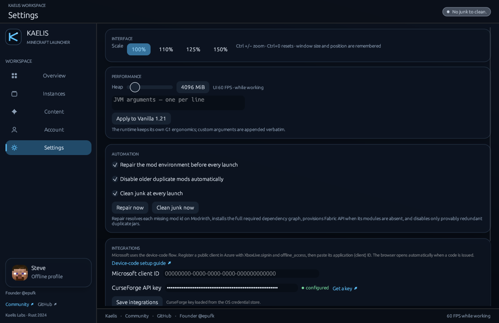
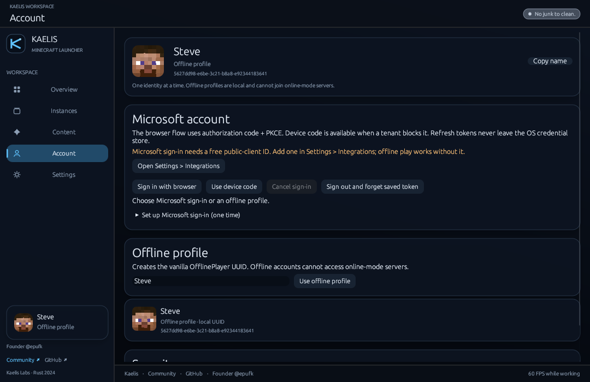

<div align="center">


# Kaelis

**Minecraft, composed.** A native Rust launcher with one calm library for
instances, modpacks, mods, resource packs, and shaders.

[Website](site/index.html) · [Releases](https://github.com/epufk/kaelis/releases) · [Issues](https://github.com/epufk/kaelis/issues) · [Community](https://discord.gg/fvrdYzrQjq)

</div>

<p align="center">
  
</p>

<p align="center">
  
</p>

<p align="center">
  
</p>

<p align="center">
  
</p>

<p align="center">
  
</p>

<p align="center">
  
</p>

Kaelis is a local-first desktop launcher for Windows 10 and 11. It pairs a
Rust workspace with a compact egui interface: no bundled browser, no JavaScript
runtime, no telemetry, and no background analytics.

## What it does

- **One Content tab.** Pick instances, modpacks, mods, resource packs, or
  shaders from a single channel strip: search and install on the left, see and
  manage exactly what is installed on the right. Modrinth and CurseForge are
  queried together for mods, packs, and shaders; modpacks come from Modrinth's
  `.mrpack` catalogue, and each row says whether that project is already
  present.
- **Modpacks are instances.** The Modpacks channel browses Modrinth `.mrpack`
  releases, reads the pack's own `minecraft` and loader dependencies, creates a
  named instance from them, imports every referenced mod and override
  transactionally, then prepares vanilla and Fabric. It works before any
  instance exists (pick a target version in the header), and dropping a
  `.mrpack` on the tab runs the same path from a local file.
- **Install or erase, never reinstall.** An uninstalled project shows one
  `Install` button; once present, that same row shows only a red `Erase`. One
  click removes every jar that project owns — including renamed and duplicate
  copies found by metadata id — and the row flips straight back to `Install`.
  The Installed list does the same per file, and the preview follows the same
  rule, so there is no separate "reinstall" flow to get stuck in.
- **The whole catalogue, not the first page.** Results are paged against both
  providers' own offsets, so `Load more` walks past the first 30 hits all the
  way to the provider total shown next to it. Nothing is truncated to an
  arbitrary result count.
- **Any site, by link.** Paste a Modrinth or CurseForge project page and it is
  resolved through the provider API and installed into the right channel — no
  HTML downloads. Paste any other direct HTTPS `.jar`/`.zip` link, a local
  path, or drop an archive anywhere on the tab; files are checked for zip
  magic, streamed under a 4 GiB cap, and sanitized to a safe filename. A
  `.mrpack` link or dropped file is treated as a pack and installed into a new
  instance instead of being copied into the current one.
- **Loaders explained, not assumed.** The Content tab flags a vanilla instance
  before you install mods, and points a shader pack session at Iris/Oculus when
  no shader loader is present.
- **An inventory you can paste.** The tab reopens on the channel you used last,
  and `Copy` puts the whole installed list on the clipboard with disabled items
  marked — handy for bug reports, pack lists, and diffs between instances.
- **Creation that explains itself.** The Instances form states what will be
  installed (`Minecraft 26.3 · fabric · mods supported`), offers the newest
  release in one click, and refuses a duplicate or empty name before any
  download starts. Names are compared against the instance that actually owns
  them, so the warning names the collision instead of blocking unrelated names;
  non-Latin names get a stable hashed folder id rather than a false conflict.
- **Loader-aware installs.** Mod dependency graphs are resolved breadth-first
  with cycle detection, strict game-version/loader validation, and a bounded
  request budget.
- **Duplicate control.** After an install, the optional repair pass disables
  older jars that claim the same primary mod id, but only when every other
  provided id remains satisfied.
- **Instance workspace.** Per-instance Java runtime, heap sizing, JVM/game
  arguments, environment, window rules, quick join, artwork, notes, groups, and
  explicit pre-launch/post-exit hooks. Cards show a cached notes preview so
  each instance carries its own description at a glance.
- **One-click erase.** `Erase` on a card (or in the editor) deletes the entire
  instance in a single step: every file under its root, its JSON record, a temp
  record from an interrupted save, queued installs for it, and every cached
  view. Nothing is archived or logged. The card reports how many files and
  bytes went with it, and the guard refuses anything that is not clearly an
  instance root — so a malformed record cannot delete a parent directory.
- **Junk that never accumulates.** With `Clean junk at every launch` enabled
  (the default), logs, crash reports, and interrupted-download staging files are
  deleted from every instance at startup, with a `Clean junk now` button for an
  immediate pass. Saves, mods, configs, resource packs, shaders, and options are
  outside the cleaner by design, so the pass can never cost a world or a jar.
- **Settings that stay small.** One screen, five compact groups: interface
  scale (80–200 %, also `Ctrl` `+`/`-`/`0`), heap and JVM arguments with an
  explicit apply target, launch automation and cleanup, provider keys, and a
  community card with Website and Discord buttons, an `Open data folder`
  shortcut, and `Copy diagnostics` (version, OS, paths, instance summary —
  never tokens, keys, or account ids).
- **Accounts that stay put.** Microsoft device-code sign-in with refresh tokens
  in the OS credential store, plus a clearly labelled offline profile that
  survives a restart. Offline accounts wear the real Steve head — the vanilla
  skin's 8×8 face, drawn as a nearest-neighbour texture, not a lookalike —
  while Microsoft accounts use their own skin. Profile heads and access tokens
  are held in memory only.
- **Managed runtime, used automatically.** Pressing Play on an instance with
  no Java installs the Mojang runtime that the version metadata asks for (into
  `runtime/<component>/<version>` inside the instance) and then launches with
  it. An explicit Java path accepts either `java.exe` or a JDK home. If nothing
  can be started, the error says so instead of "program not found".
- **Honest logging.** The instance log is a bounded in-memory ring buffer. It
  is discarded with the process and exported only when the user asks.

## Quick start

Requirements: Windows 10/11, Rust 1.85 or newer, and a C/C++ linker for the
selected Rust target.

```bash
git clone https://github.com/epufk/kaelis.git
cd kaelis
cargo build --release -p kaelis-launcher
```

Run `target/release/kaelis.exe`, or launch a saved instance directly:

```bash
kaelis --play fabric-1-21
```

Both Modrinth and CurseForge are supported. CurseForge searches require an API
key; add it in **Settings → Integrations**. It is stored in the operating-system
credential store, never in instance JSON or the repository.

Those two are the public catalogues with documented APIs for Minecraft mods,
resource packs, and shaders. Sites without an API — SpigotMC, Planet
Minecraft, 9Minecraft, GitHub release pages, private packs — are covered by the
link and local-file paths instead of scrapers, so traffic stays predictable and
within each site's terms.

## Workspace

```text
crates/
  kaelis-core/       brand, instance metadata, JVM flags, junk cleaner,
                     RAM-only log, single-instance mutex, memory sweeper
  kaelis-api/        Mojang versions, Modrinth, CurseForge, downloads,
                     mrpack import, repair, hashing, auth, launch pipeline
  kaelis-gui/        egui interface, content studio, instance editor, tray
  kaelis-launcher/   CLI and desktop entry point
site/                static product site and brand assets
```

Instances are plain JSON under the platform data directory
(`%APPDATA%\kaelis\Kaelis\data\instances` on Windows by default). Set
`KAELIS_DATA_DIR` to relocate all launcher state; each data root also gets its
own single-instance guard, so a portable copy never blocks the installed one.

## Design rules

- Native first: every hot path stays in Rust; the UI is immediate-mode and
  paints only when needed — forced repaints run at 60 FPS only while an install
  or progress bar is on screen, and an idle launcher is fully event-driven.
- Bounded everything: image decodes, log lines, dependency walks, download
  concurrency, archive extraction, and retry loops all have hard limits.
- One pass per download: SHA-1 is computed from the stream while bytes are
  written, so a verified install never re-reads the file it just saved.
- Explicit automation: repair, duplicate resolution, and the junk cleaner are
  visible settings with conservative safety proofs, never silent mutations of
  user data.
- No hidden state: no cache daemon, no persistent event log, no telemetry endpoint.
- Small releases: fat LTO, one codegen unit, stripped symbols, abort on panic.

## Verification

```bash
cargo test --workspace
cargo clippy --workspace --all-targets -- -D warnings
cargo fmt --all -- --check
```

## Website

The product site is a single dependency-free HTML document in
[`site/`](site/index.html). The Pages workflow at
[`.github/workflows/pages.yml`](.github/workflows/pages.yml) deploys that
directory on a push to `main`; enable GitHub Pages → GitHub Actions once in the
repository settings. Brand artwork lives in
[`site/assets/kaelis-mark.svg`](site/assets/kaelis-mark.svg).

## License

MIT · Kaelis Labs · Founder [@epufk](https://github.com/epufk)

Kaelis is not affiliated with Mojang Studios, Microsoft, Modrinth, or
CurseForge. Minecraft is a trademark of Mojang Studios.
