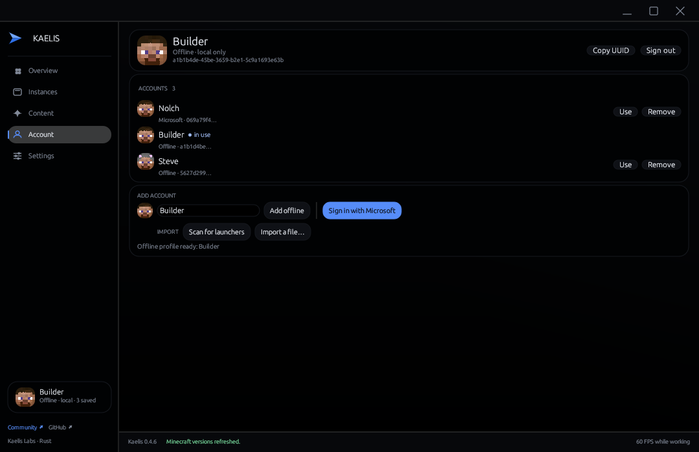

<p align="center">
  
</p>

<h1 align="center">Kaelis</h1>

<p align="center"><b>The fastest, lightest Minecraft launcher.</b><br>
Native Rust for Windows, macOS, and Linux.</p>

<p align="center">
  <a href="https://fuvji.github.io/kaelis/">Website</a> ·
  <a href="https://github.com/fuvji/kaelis/releases">Releases</a> ·
  <a href="CHANGELOG.md">Changelog</a> ·
  <a href="https://discord.gg/fvrdYzrQjq">Discord</a>
</p>

<p align="center">
  
  
  
  
</p>

<p align="center">
  <a href="https://twitter.com/intent/tweet?text=Kaelis%20%E2%80%94%20a%20native%20Rust%20Minecraft%20launcher%20that%20opens%20in%20297%20ms%20and%20idles%20at%200.00%25%20CPU.&hashtags=Kaelis,Minecraft,Rust&url=https%3A%2F%2Ffuvji.github.io%2Fkaelis%2F">Share <b>#Kaelis</b></a> ·
  <a href="https://www.reddit.com/submit?url=https%3A%2F%2Ffuvji.github.io%2Fkaelis%2F&title=Kaelis%20%E2%80%94%20the%20fastest%2C%20lightest%20Minecraft%20launcher">Reddit</a> ·
  <a href="https://github.com/fuvji/kaelis/stargazers">Star on GitHub</a>
</p>



Instances, mods, modpacks, resource packs, shaders, and accounts in one window.
Files stay local, nothing runs in the background, and the library is one screen
away.

**For contributors and agents:** [project brain](docs/brain/Kaelis%20Brain.md) ·
[agent contract](AGENTS.md).

## Features

| | |
| --- | --- |
| **Auto Erase Junk** | Logs, caches, and stale launcher state go at every start. Saves, mods, and configs never do. |
| **One copy of the game** | Verified files are hard-linked once, so a second instance costs MB, not 600 MB. |
| **Auto-repair** | A missing JVM, jar, library, asset, or loader is refilled before the game starts. |
| **Required dependencies** | Every install resolves and downloads its dependency graph, on both catalogues. |
| **Verified mod updates** | Newest compatible release per mod, installed only after its hash matches. |
| **Keyless catalogue** | All of Modrinth and CurseForge. No API key, no account. |
| **Managed Java** | The runtime the version names, installed on first play. |
| **Portable instances** | `.kaelis.zip` round trip, plus Prism/MultiMC, CurseForge, and `.mrpack` imports. |
| **Realtime-priority games** | Every JVM is promoted at spawn — realtime where Windows grants it, high everywhere else — and the launcher holds a 0.5 ms timer for as long as it runs. |
| **Runs in parallel** | Per-instance guards let different instances run at once. |
| **Reopens, never doubles** | One process, one tray icon. A second launch restores the window in ~120 ms. |
| **Hibernates while you play** | Hides and empties its working set; one tray click brings it back. |
| **Taskbar-friendly** | Keeps its taskbar button and Alt+Tab entry; the tray's Hide is opt-in. |
| **Starts with Windows** | Optional per-user entry, tray-hidden, no service or scheduled task. |
| **Survives a restart** | A running game still shows as running after the launcher reopens. |
| **Remembers your setup** | Window size and every remembered switch reopen as they were left. |
| **Updates in one click** | SHA-256 verified against the release, backed up, rolled back on failure. |
| **Private by default** | No telemetry, no daemon; tokens live in the OS keychain. |

**Auto Erase Junk never guesses.** It removes only what Minecraft or Kaelis
regenerates on the next launch: logs, crash dumps, loader and download caches,
extracted natives, staging files, OS thumbnail noise, and another launcher's
leftovers. Saves, mods, configuration, resource packs, shaders, screenshots,
options, and every folder it does not recognise stay. A symlinked instance root
is refused rather than followed, and a hostile folder cannot slow startup past
50,000 inspected entries. The first pass runs off the UI thread and after every
game; `kaelis --clean [--json]` runs it headless.

**The same bytes are stored once.** A verified file is hard-linked into
`<data>/content` by SHA-1 before any later instance asks for it, so a second
instance of the same version links 443 MB of assets, 66 MB of libraries, the
client jar, and the 100 MB Java runtime instead of downloading them. Deleting an
instance never damages another, and unreferenced entries are pruned.

## Content

Both catalogues are keyless. Modrinth is the official API; CurseForge is read
through the public mirror of its v1 API, with the same paths, JSON, pagination,
and file metadata as the official endpoint. Files come from the official CDN
with hash and required-dependency checks. An approved key in `CF_API_KEY` aims
the same calls at the official endpoint. Sites without an API are covered by
link and local-file import, never scrapers.

## Install

| Platform | Downloads |
| --- | --- |
| **Windows 10 / 11 · x64** | [Portable ZIP](https://github.com/fuvji/kaelis/releases/latest/download/Kaelis-Portable.zip) · [Kaelis.exe](https://github.com/fuvji/kaelis/releases/latest/download/Kaelis.exe) · [Installer](https://github.com/fuvji/kaelis/releases/latest/download/Kaelis-Setup.exe) |
| **macOS 11+** | [Universal DMG](https://github.com/fuvji/kaelis/releases/latest/download/Kaelis-macos-universal.dmg) · [ZIP](https://github.com/fuvji/kaelis/releases/latest/download/Kaelis-macos-universal.zip) |
| **Linux · x64** | [.deb](https://github.com/fuvji/kaelis/releases/latest/download/Kaelis-linux-x64.deb) · [AppImage](https://github.com/fuvji/kaelis/releases/latest/download/Kaelis-linux-x64.AppImage) · [tar.gz](https://github.com/fuvji/kaelis/releases/latest/download/Kaelis-linux-x64.tar.gz) |

No admin rights, no runtime to install, no account to create. The Windows build
is unsigned, so SmartScreen may ask once; the macOS build is ad-hoc signed, so
the first launch is right-click → Open. Verify before running:

```bash
shasum -a 256 -c SHA256SUMS.txt     # certutil -hashfile Kaelis.exe SHA256
```

Every artifact is listed in [SHA256SUMS.txt](https://fuvji.github.io/kaelis/downloads/SHA256SUMS.txt)
and the [URL & install index](https://fuvji.github.io/kaelis/downloads/KAELIS-LINKS.txt).

## Performance

Measured on one machine on 2026-11-10, 0.3.7, 0.4.5 and 0.4.6, with the same
`target/bench-lite.ps1` harness and three runs per build.

| Metric | 0.3.7 | 0.4.5 | 0.4.6 |
| --- | --- | --- | --- |
| `kaelis --version` | 62.5 ms | 63.0 ms | 63.1 ms |
| Window, empty data root | 285.3 ms | 288.8 ms | 296.8 ms |
| Working set, idle | 86.6 MB | 19.4 MB | 18.9 MB |
| Binary size | 16.44 MB | 16.43 MB | 16.45 MB |
| Idle CPU, window shown | 0.00% | 0.00% | 0.00% |

The real change is memory: **86.6 MB → 18.9 MB**, a 78% smaller idle working
set. Window and CLI times move by more than the difference between releases on
this host, so they are not presented as speedups. Binary size is within 20 KB
across all three builds. The native cache added in 0.4.6 removes a repeated
unzip after a version is prepared; it does not change window creation.

An idle launcher schedules no frames, and a hidden one is off the schedule
entirely. Window time moves with host load; working set and idle CPU are the
figures that stay put.

## Command line

Every screen has a headless equivalent. `--json` prints one machine-readable
document on stdout, so scripts and agents can parse it without a GUI.

| Command | Does |
| --- | --- |
| `kaelis` | Open the launcher |
| `kaelis --version [--json]` | Build identity, platform, site and checksum URLs |
| `kaelis --status [--json]` | Data root, instance and account counts, resolved Java |
| `kaelis --clean [--json]` | Erase junk, share legacy files, prune the cache |
| `kaelis --list-instances [--json]` | Every instance: id, name, version, loader, mods |
| `kaelis --list-versions [--show-alpha] [--show-beta] [--hide-snapshots]` | Newest Mojang versions |
| `kaelis --accounts [--json]` | Every saved identity and the active one |
| `kaelis --use-account <name>` | Switch the identity the next launch uses |
| `kaelis --offline <name> [--json]` | Offline profile and its skin head URL |
| `kaelis --play <instance> [--offline <name>]` | Launch with the managed runtime |
| `kaelis --check-updates <instance> [--json]` | Newest compatible mod version for every jar |
| `kaelis --update-mods <instance> [--json]` | Download, verify, and install those updates |
| `kaelis --install-mod <instance> <provider:project>` | Install a mod and its dependencies |
| `kaelis --repair <instance>` | Reinstall missing required dependencies |
| `kaelis --import-modpack <instance> <pack>` | Import an `.mrpack` or `.zip` pack |
| `kaelis --export-instance <instance> <out.kaelis.zip>` | Write one portable archive |
| `kaelis --import-instance <archive>` | Import it under a free id |
| `kaelis --duplicate <instance> [--with-worlds]` | Copy an instance; worlds are opt-in |

Exit codes are stable: `0` success, `2` bad arguments, anything else a runtime
failure. A second GUI launch hands its arguments to the running window.

## Accounts

Offline profiles need only a name. Microsoft sign-in needs no setup: it shows a
short code, opens the Microsoft page, and finishes when the page is approved —
no Azure registration, no client id, no secret. Every sign-in is exchanged
through Xbox Live → XSTS → Minecraft Services, so an account without Java
Edition is refused at sign-in rather than at launch. The refresh token lives in
the OS credential store; the access token stays in zeroising memory.

## What's new in 0.4.6

0.4.6 resumes the 0.4.x line requested for the product; the 0.5.0 and 0.6.0
notes below are kept as history.

- **A compact aurora page.** The product page is a tighter single column of
  information with a slow, GPU-composited aurora behind it, a three-across
  preview grid, two-across feature and performance rows, and no oversized
  share block. It still loads nothing from a third party.
- **Packaging reads the real version.** The Linux and macOS packaging scripts
  read the workspace manifest instead of a crate manifest that only says
  `version.workspace = true`, so AppImage, DMG and bundle metadata no longer
  fall back to an empty or placeholder version.
- **Measured again.** 0.4.6: 297 ms to a window, 63 ms for `--version`, 18.9 MB
  idle working set and 0.00% idle CPU, from the same harness as 0.4.5.

## What's new in 0.6.0

- **Natives unpack once.** The first launch of a version extracts its LWJGL,
  JNA and Netty natives into a cache keyed by the version document and each
  native jar's size and mtime. Later launches reuse the directory instead of
  unzipping the same jars again; a changed jar produces a new key, so stale
  DLLs are never reused, and extraction is published with one rename so a
  cancelled launch leaves no half-written cache behind.
- **The benchmark table is visual.** The product page charts the measured
  0.3.7 → 0.4.6 numbers, keeps all seven real screenshots, and reveals sections
  on scroll without a framework or a third-party request.
- **Sponsorship is direct and labelled.** GitHub Sponsors is linked from the
  repository and the page, with one hand-reviewed sponsor slot and no ad
  script, cookie or affiliate redirect.

Full history in [CHANGELOG.md](CHANGELOG.md).

## What's new in 0.5.0

- **Realtime games.** A launched JVM is promoted to `REALTIME_PRIORITY_CLASS`
  and, when the desktop refuses that privilege, to `HIGH_PRIORITY_CLASS`. It is
  also opted out of EcoQoS, so a backgrounded game keeps the fast cores.
- **A 0.5 ms tick.** The scheduler resolution is locked for exactly the life of
  the game and released on every exit path, with a 1 ms `timeBeginPeriod`
  fallback.
- **Leaner JVM flags.** Parallel reference processing, no shared `hsperfdata`
  mapping, and HotSpot's own region, survivor, and thread ergonomics. GC pause
  targets and explicit-GC suppression stay out because they are unmeasured.
- **Instant first frame.** The older-build scan moved off the window thread.

Full history in [CHANGELOG.md](CHANGELOG.md).

## Licence

Proprietary · © 2026 Kaelis Labs · [@epufk](https://github.com/fuvji)

Free to download and use. Not free to redistribute, modify, or repackage. See
[LICENSE](LICENSE).

Kaelis is not affiliated with Mojang Studios, Microsoft, Modrinth, or
CurseForge. Minecraft is a trademark of Mojang Studios.
