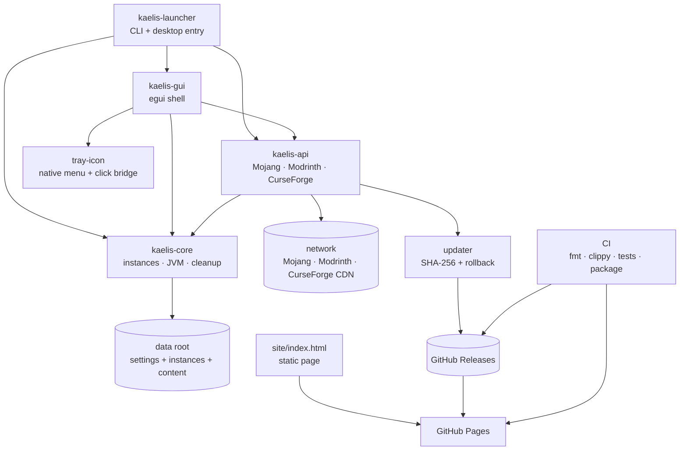

# Kaelis Repo Graph

Generated graph for navigation, not a second architecture spec. The manifests and
workflows are the evidence; update this note when an edge changes.



## Crate edges

| From | Direct edges | Evidence |
| --- | --- | --- |
| `kaelis-launcher` | `kaelis-core`, `kaelis-api`, `kaelis-gui` | `crates/kaelis-launcher/Cargo.toml` |
| `kaelis-gui` | `kaelis-core`, `kaelis-api` | `crates/kaelis-gui/Cargo.toml` |
| `kaelis-api` | `kaelis-core` | `crates/kaelis-api/Cargo.toml` |
| `kaelis-core` | platform/data primitives only | `crates/kaelis-core/Cargo.toml` |

## Runtime flow

1. The launcher claims the single-instance guard, parses the CLI, then opens the
   GUI or runs one headless action.
2. The GUI owns presentation and user actions; the API owns network, auth,
   content, repair and launch work; core owns instance metadata, JVM flags,
   cleanup and local runtime primitives.
3. Instance state is plain JSON under the platform data root. Verified content
   is hard-linked from the shared store; a failed hash never installs.
4. A launched game is registered by pid plus creation time. The launcher hides
   only for that game and returns only when its own flag says it hid the window.

## Release and page flow

```text
push tag v* ──> Windows x64 ─┐
             ├─ Linux x64 ───┼─> SHA256SUMS.txt ─> GitHub Release
             └─ macOS univ. ─┘                         │
                                                        ▼
main site/** ─────────────────────────────────────> Deploy Pages
                                                        │
                        hydrate sizes + SHA-256 ────────┘
```

The page is one static document. Release assets are served from GitHub
Releases; Pages keeps only the page, checksums, link index, README and licence.
The download picker is progressive enhancement: every artifact row is a direct
link without JavaScript.

## Artifact matrix

| Platform | Artifacts | Architecture |
| --- | --- | --- |
| Windows 10/11 | standalone portable EXE | x64 |
| macOS 11+ | universal DMG, universal ZIP | Apple silicon + Intel |
| Linux | `.deb`, AppImage, `tar.gz` | x64 |

## Reading rule

Find the owning crate before editing, then verify the edge in `Cargo.toml`, the
release workflow or the page source. Do not infer a dependency from a shared
concept. Do not copy Droplet-only modules, item icons or cheat mechanics into
Kaelis; the two projects have separate contracts.

## Links

- [[Kaelis Brain]]
- [[Kaelis Architecture]]
- [[Kaelis Build And Release]]
- [[Kaelis Web System]]
